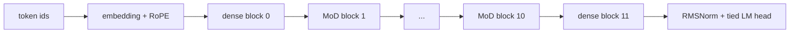

# LiteMoD

**A compute-light language model designed to pretrain faster than a same-size dense transformer on TinyStories.**

LiteMoD keeps the dense model's parameter count but does **not** run every token through every block. Each routed block scores its tokens and processes only the top `capacity × T` of them; the rest skip the block through the residual stream. The result is fewer active FLOPs per token — especially in attention, which shrinks quadratically with the routed sequence length.

This repo contains the full TinyStories pipeline, a dense baseline, a wall-clock speed benchmark, and the exact commands to run both on a Vast.ai GPU.

> **Status:** the code was generated and pushed without a local GPU run (per request). No measured benchmark numbers are hard-coded in this README; the table above is analytical. `src/bench.py` is the source of truth for speed on your GPU.

---

## What is compared

| model | total params | active depth | est. training MFLOPs/token @ seq 512 | relative FLOPs |
|---|---:|---:|---:|---:|
| `dense` | 42.2M | 12.0 | 291.0 | 1.00× |
| `fast` / LiteMoD (capacity 0.5) | 42.2M | 7.0 | 182.9 | 0.63× |

Both models use:

- 12 layers, `d_model=512`, 8 query heads, 2 KV heads (GQA), SwiGLU, RMSNorm, RoPE
- a 16k byte-level BPE tokenizer trained on TinyStories
- tied input/output embeddings
- the same optimizer, batch size, sequence length, data order, and LR schedule

The **only** architectural difference is that 10 of the 12 blocks in LiteMoD are `MoDBlock`s. Blocks 0 and 11 stay dense. The fast model adds only the routers (~5k parameters total).

The table is an analytical estimate (3× forward-pass model FLOPs for forward + backward), not a measurement. At capacity 0.5 the theoretical active-FLOP reduction at 512 tokens is **~37%**, so the idealized FLOP-ratio ceiling is **~1.59×**. Real wall-clock speedup is lower because the LM head and the smaller GEMMs do not shrink, and it depends on the GPU. Run the benchmark to get the real number.

---

## The idea in one picture



Inside a `MoDBlock`:

```text
x ──► router (d → 1) ──► top-k token indices (sorted by position)
 │                              │
 │                              ├──► gather selected tokens
 │                              │       attention + SwiGLU
 │                              │       scatter back
 └──────────────────────────────┴──► residual add (unselected tokens unchanged)
```

Because selected indices are sorted by their **original position**, the usual lower-triangular causal mask is still exactly correct after gathering. That keeps the fast path on PyTorch's fused `scaled_dot_product_attention` / FlashAttention kernel.

The router is trained with the standard MoD auxiliary loss: binary cross-entropy against its own top-k selection, plus a small router z-loss. Gumbel noise is added **only to the selection logits during training** so the router does not collapse onto a fixed positional subset; the auxiliary loss always sees clean logits. At evaluation time routing is deterministic top-k, which makes dense/fast loss comparisons reproducible.

### Why a custom 16k tokenizer?

At 42M parameters, the LM head `(vocab × d_model)` is a meaningful fraction of total FLOPs. A 16k TinyStories BPE instead of GPT-2's 50k vocabulary cuts that head cost by ~3×, which makes the MoD compute savings visible in wall-clock time. TinyStories is simple enough that 16k tokens is plenty.

---

## Quick start on Vast.ai

Pick a template with **PyTorch ≥ 2.3, CUDA 12.1+**, and a GPU with **≥ 24 GB** (RTX 4090, A100, L40S, etc.).

```bash
# on the Vast.ai instance
git clone https://github.com/modhisathvik7733/xyz.git
cd xyz
bash scripts/setup_vastai.sh
```

### 1. Build the TinyStories tokenizer + packed token files (one time)

```bash
bash scripts/prepare_data.sh
# equivalent:
# python -u -m src.prepare_data \
#   --dataset roneneldan/TinyStories \
#   --out-dir data \
#   --vocab-size 16384 \
#   --tokenizer-sample 200000
```

This downloads TinyStories, fits a 16k BPE tokenizer on 200k stories, and writes:

```text
data/tokenizer.json
data/train.bin      # uint16 packed tokens
data/val.bin
data/meta.json      # vocab_size, token counts, EOS id
```

Re-run with `--force` to rebuild. Expect a few GB of disk including the Hugging Face cache. The dataset is downloaded at runtime and is not redistributed here; TinyStories is released under CDLA-Sharing-1.0.

### 2. Speed check (the main point)

This uses random tokens and reuses one batch, so it isolates the model + optimizer step from data loading. It prints tokens/sec and speedup for every `(sequence length, batch size)` pair, and writes `bench_results.json`.

```bash
bash scripts/speed_check.sh

# equivalent:
# python -u -m src.bench \
#   --dense configs/dense_tiny.yaml \
#   --fast configs/fast_tiny.yaml \
#   --batch-sizes 8,16,32 \
#   --seq-lens 256,512 \
#   --warmup 5 --iters 20 --compile
```

Start with `--batch-sizes 8,16 --seq-lens 256,512` if you are on a 24 GB card and want a quick run. OOM combinations are skipped automatically and marked in the JSON.

### 3. Train both models

```bash
mkdir -p runs
tmux new -s litmod          # keeps the run alive if SSH drops

python -u -m src.train --config configs/dense_tiny.yaml --compile \
  2>&1 | tee runs/dense.log

python -u -m src.train --config configs/fast_tiny.yaml --compile \
  2>&1 | tee runs/fast.log
```

Or run both sequentially:

```bash
bash scripts/train_both.sh
```

`4000` steps at `32 × 2 × 512 = 32,768` tokens/step is **131.1M tokens**. On a 4090/A100 this is a short run (tens of minutes, depending on the GPU); measure it on your instance.

Useful variants:

```bash
# time-boxed equal-wall-clock comparison (30 minutes per model)
bash scripts/train_both.sh --max-minutes 30

# skip torch.compile if your image has a compile/Triton problem
NO_COMPILE=1 bash scripts/train_both.sh

# OOM: keep the same tokens/step, use more accumulation
python -m src.train --config configs/fast_tiny.yaml \
  --set train.batch_size=16 --set train.grad_accum=4 --compile

# resume
python -m src.train --config configs/fast_tiny.yaml --resume auto --compile

# try a different routing capacity
python -m src.train --config configs/fast_tiny.yaml \
  --set model.mod_capacity=0.6 --compile
```

### 4. Plot the comparison

```bash
python analysis/plot.py \
  --dense runs/dense_tiny/metrics.csv \
  --fast  runs/fast_tiny/metrics.csv \
  --out   runs/compare.png
```

The script writes three panels: train loss vs tokens, validation loss vs tokens, and throughput vs tokens.

---

## Reading the speed-check output

`src/bench.py` prints a table like this (column names only — run it for numbers):

```text
model     seq  batch  tok/step    ms/step         tok/s  peak GB  Est. TFLOP/s
dense     512     32   16,384       ...            ...      ...      ...
fast      512     32   16,384       ...            ...      ...      ...
```

Then:

```text
Speedup (fast / dense, same seq+batch):
  seq  batch   dense tok/s   fast tok/s  speedup
  512     32           ...           ...     ...x
```

- `tok/s` is measured after `--warmup` steps, with CUDA synchronization, and is the median over `--iters`.
- `Est. TFLOP/s` uses the analytical **training** active FLOPs for that architecture (3× forward), so it is an effective throughput estimate, not a hardware peak.
- `--compile` compiles each shape on its first warmup step. The compile time is not included in the timing.
- For a clean comparison, use the same `--dtype`, batch size, sequence length, and compile setting for both models.

The training CSV (`runs/*/metrics.csv`) also logs `tok_per_sec`, `val_loss`, `grad_norm`, and peak memory. Validation time is excluded from `tok_per_sec`; use `bench.py` for the clean model-step number.

---

## Repo layout

```text
.
├── configs/
│   ├── dense_tiny.yaml       # 12-layer dense baseline
│   └── fast_tiny.yaml        # same model, 10 MoD blocks
├── src/
│   ├── model.py              # DenseBlock, MoDBlock, GQA/RoPE/SwiGLU, LiteMoD
│   ├── flops.py              # analytical params + active FLOPs
│   ├── data.py               # memmap packed-token sampler
│   ├── prepare_data.py       # TinyStories download, BPE training, packing
│   ├── train.py              # training loop, AMP, compile, CSV, checkpoints
│   └── bench.py              # wall-clock dense-vs-fast benchmark
├── analysis/plot.py          # training curves -> runs/compare.png
├── scripts/
│   ├── setup_vastai.sh
│   ├── prepare_data.sh
│   ├── speed_check.sh
│   └── train_both.sh
├── requirements.txt
└── README.md
```

---

## Implementation notes

- **Attention:** `F.scaled_dot_product_attention(..., is_causal=True)`, so PyTorch uses FlashAttention / memory-efficient kernels on CUDA. GQA KV heads are expanded with `repeat_interleave` for compatibility with older torch versions.
- **Routing:** exact top-k per batch item; `k = round(capacity × T)`. Selected indices are sorted before attention. Scatter uses the same index tensor, so unselected tokens keep their residual exactly.
- **Router loss:** `BCEWithLogits(clean_logits, topk_mask) + z_weight * mean(logits²)`, averaged over routed blocks and weighted by `mod_aux_weight` in the total loss.
- **Exploration:** Gumbel noise on selection logits during training; disabled at eval. Set `model.mod_router_noise=0` to disable.
- **AMP:** bf16 by default; fp16 is supported with a grad scaler; `dtype: fp32` works too.
- **Compile:** optional `torch.compile`; the model keeps the state dict under `_orig_mod` handling in checkpoints.
- **Reproducibility:** the packed-token sampler derives its RNG from `(seed, step)`, so dense and fast see identical batches at identical steps, and resume is deterministic.

### Analytical FLOP model

Per dense layer, per token: `4·d²·(1 + n_kv/n_head) + 6·d·mlp_hidden` linear FLOPs, plus `4·T·d` attention FLOPs. For a routed layer with `K = c·T`, the linear term is scaled by `c`, attention by `c²`, and a small router term is added. The LM head adds `2·d·vocab` per token. Run:

```bash
python -m src.flops --seq-len 512
```

---

## Troubleshooting

- **`torch.compile` fails or Triton is missing:** run without compile. For training, `NO_COMPILE=1 bash scripts/train_both.sh`; for the speed check, `NO_COMPILE=1 bash scripts/speed_check.sh`. You can also omit `--compile` from the direct `python -m ...` commands.
- **CUDA OOM:** lower `train.batch_size` and raise `train.grad_accum` to keep tokens/step constant; for the benchmark, pass a smaller `--batch-sizes` or `--seq-lens`.
- **No bf16 support** (V100/T4-class): add `--set train.dtype=fp16` to training. The benchmark accepts `--dtype fp16`.
- **SSH disconnects:** run inside `tmux` (`apt-get update && apt-get install -y tmux` if missing) and use `tee` logs.
- **Hugging Face download issues:** set `HF_HOME=/workspace/.hf` and re-run `scripts/prepare_data.sh`; the dataset is public and needs no token.

---

## Fairness / limitations

- **Same tokens, same steps:** the default training configs give both models identical batch size, sequence length, optimizer steps, and data order. The fast model is not being compared against a larger or better-tuned baseline.
- **Time-boxed runs use the step-based schedule.** With `--max-minutes`, the faster model completes more steps (and is further along the cosine schedule) within the window. That is the intended speed advantage; increase `max_steps` if the fast model finishes before the time limit.
- **Quality is not guaranteed to match at equal tokens.** MoD trades depth for throughput; at equal token count a dense model can have lower loss. The interesting comparison is **loss at equal wall-clock time** — use `--max-minutes` and compare the validation curves.
- **Wall-clock < FLOP ratio.** The LM head, small matrix multiplications, router/gather/scatter overhead, and kernel launch latency eat into the theoretical 1.59×. On a 4090/A100, expect a smaller measured speedup; the benchmark reports it honestly.
- **Fixed top-k at eval.** This implementation uses deterministic capacity routing for both training and validation. It does not implement per-token thresholded inference or a KV-cache-aware generation path.
- **Single GPU.** The training loop is intentionally single-process/single-GPU; there is no DDP wrapper. A multi-GPU run would need a distributed sampler and DDP around the model.
- **No local test was run.** This machine has no CUDA GPU, and the request explicitly said not to run a local test. Static checks were limited to syntax/config validation.

---

## References

- Raposo et al., *Mixture-of-Depths: Dynamically allocating compute in transformer-based language models*, arXiv:2404.02258 (2024).
- Eldan & Li, *TinyStories: How Small Can Language Models Be and Still Speak Coherent English?*, arXiv:2305.07759 (2023).
- GPT-2 / nanoGPT for the transformer baseline conventions; SwiGLU and GQA follow the LLaMA family.

## License

MIT. See [LICENSE](LICENSE).
